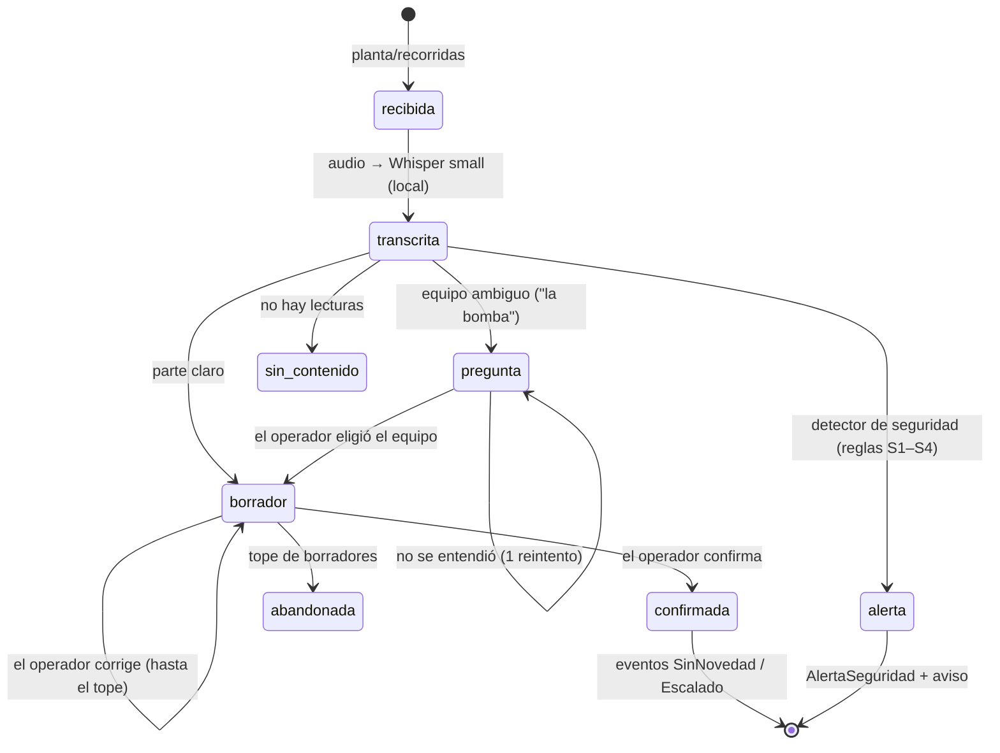

# Spec · Flujo del parte por voz

> Spec-Driven Development (módulo 1.4): contexto, restricciones, criterios de aceptación verificables y ejemplos.
> Implementación: `src/sistema/agente.py` (orquestación), `procesamiento/{stt,seguridad,numeros,parte,dialogo}.py`,
> `dominio/{planta,deteccion}.py`. Verificación: `tests/` y la suite de `evaluacion/`.

## Contexto

El operador recorre la planta dos veces por turno y dicta notas de voz que pueden mezclar equipos y datos en
cualquier orden. La planta publica cada nota en `planta/recorridas` (`NotaRecorrida`: id, ts, audio WAV 16 kHz con
ruido de planta, fotos). El sistema arma el parte, se lo muestra al operador en la tablet (`sistema/tablet`), entiende
su respuesta en texto libre (`planta/respuestas`) y, con el parte confirmado, genera los eventos de detección
(`sistema/eventos`).

## Restricciones

- **Todo en la PC de planta, sin enlace ni nube:** transcripción y LLM locales, dentro de 4 CPU y 8 GB sin GPU
  (compartidos con Postgres y las herramientas).
- **Condición insegura:** `AlertaSeguridad` y aviso en la tablet en **menos de 30 s reales** desde que llega la nota,
  sin modelos de lenguaje y sin falsas alarmas.
- **Hora del parte = `ts` de la nota**, nunca el reloj de la máquina.
- **Límites y conversiones en código** (hoja de datos de `/api/planta`, nunca el manual Rev. C).
- **Control por nota:** timeout global (`TIMEOUT_NOTA_S`, 180 s), presupuesto de pasos de LLM y de tokens
  (`MAX_PASOS_LLM_POR_NOTA`, `MAX_TOKENS_POR_NOTA`) y tope de borradores (`MAX_INTENTOS_BORRADOR`). Al agotarse
  cualquiera, la nota queda `abandonada` con el motivo en el registro de pasos.
- **El texto de la nota es dato:** entra delimitado (`<nota>…</nota>`) y no cambia ninguna regla.

## Flujo y estados

Cada transición se guarda en Postgres (`notas`, `mensajes_tablet`, `partes`): el diálogo sobrevive a un reinicio.

## Pasos

1. **Transcripción:** se baja el audio de `http://sim:8100{audio_url}` y se transcribe con faster-whisper `small`
   int8 en español, con un prompt con el vocabulario de la planta. Una transcripción por vez.
2. **Seguridad:** reglas sobre la transcripción (`seguridad.detectar`). Si hay condición insegura, se publican el aviso
   (`espera_respuesta: false`, procedimiento de emergencia y aviso por radio al supervisor) y `AlertaSeguridad`, se
   encola para la nube y la nota termina ahí.
3. **Números:** `numeros.normalizar_numeros` pasa los números hablados a dígitos ("mil seiscientos cuarenta" → 1640,
   "uno ocho" → 1.8) y repara los diferenciales que la transcripción parte ("uno, dos" → 1.2).
4. **Extracción:** el LLM local devuelve `Dictado` (JSON Schema, validado con Pydantic): por fila, el equipo como lo
   dijo, la variable, el valor, la unidad si la dijo y si sacó foto.
5. **Reglas** (`parte.armar_borrador`): TAG por los nombres informales de `/api/planta`; unidad por defecto según el
   manómetro de cada bomba (B-101 kg/cm², B-102 psi, B-103 bar); "la bomba" a secas → ambiguo; un diferencial ≥ 10
   → se propone el valor / 10 y se pregunta; fotos a la fila donde dijo que sacó foto.
6. **Rango histórico:** para las lecturas con sensor equivalente (`presion_descarga_local` → `presion_descarga`,
   `presion_diferencial`), percentiles 1–99 de 45 días del historiador con 3 % de margen. Fuera de rango, el borrador
   lo avisa y pide confirmación en el texto.
7. **Tablet:** pregunta de equipo (con `opciones`, sin filas), o borrador (filas sin `opciones`; con `opciones` solo si
   hay un valor ambiguo).
8. **Respuesta:** reglas para las formas conocidas ("Sí, confirmo", "La dos estaba en 115 kilos, no en 150", "Eso de
   1,8 era del filtro B", "Lo de la dos es en psi", "Te faltó…", "Lo de … no lo dije") y nuevo borrador con lo
   corregido.
9. **Confirmado:** parte `Confirmado`, un `EventoSistema` por equipo (`EV-<nota>-<TAG>`, idempotente, `origen: parte`,
   `nota_ids`), `Escalado` con su contexto (parte, fotos, tendencia de 6 h) a la cola hacia la nube.

## Criterios de aceptación

| # | Criterio | Cómo se verifica |
| --- | --- | --- |
| CA-1 | Toda nota del operador recibe al menos un mensaje en la tablet con filas | corrector A1; `evaluacion/` |
| CA-2 | El primer borrador coincide con lo dicho (TAG, valor y unidad, con la tolerancia del operador) | corrector A2; `evaluacion/llm` con `planta_sim.dialogo._comparar` |
| CA-3 | Después de las correcciones, el parte queda confirmado | corrector A3 |
| CA-4 | Pregunta en las notas con "la bomba" a secas o un diferencial dicho "dieciocho" | corrector A4a; `tests/test_dialogo.py` |
| CA-5 | No pregunta en notas claras: borradores sin `opciones` | corrector A4b |
| CA-6 | Cada equipo de un parte confirmado tiene su evento; observación o valor fuera de alarma → `Escalado`; "parada, en reserva" → `SinNovedad` | corrector B1; `tests/test_deteccion.py` |
| CA-7 | Nota con S1–S4 → `AlertaSeguridad` + aviso en < 30 s reales; ninguna alerta en notas normales | corrector B2; `tests/test_seguridad.py` |
| CA-8 | Ningún mensaje inválido contra `planta_contrato` | corrector F1 (todo se valida antes de publicar) |
| CA-9 | La transcripción tiene todos los números bien en ≥ 95 % de las notas del banco de voces con ruido, con p95 < 10 s en 2 CPU | `evaluacion/stt` |

## Ejemplos (notas reales de la planta)

| Nota | Esperado |
| --- | --- |
| "La del medio está en mil seiscientos cuarenta psi de descarga, sigue goteando por la empaquetadura, le saqué foto, el rodamiento me dio cincuenta y dos grados con la pistola. El filtro A me dio uno cinco de diferencial, le saqué foto al manómetro." | Filas: B-102 1640 psi · B-102 goteo (foto) · B-102 52 °C · F-201A 1,5 kg/cm² (foto). Eventos: B-102 `Escalado` (goteo), F-201A `Escalado` (1,5 ≥ alarma alta) |
| "La tres está parada, en reserva. La de la punta está en ciento diez de descarga." | B-103 estado "parada, en reserva" · B-101 110 kg/cm². Ambos `SinNovedad` |
| "La bomba está en ciento doce de descarga." | Pregunta "¿de qué bomba hablás?" con opciones La uno / La dos / La tres; después el borrador |
| "El filtro B me dio dieciocho de diferencial." | Borrador con F-201B 1,8 y opciones "Sí, 1,8" / "No, 18" |
| "¡Atención! Se rompió algo en la descarga de la uno, sale agua a presión para todos lados, me alejé." | Aviso de emergencia + `AlertaSeguridad` S1 en B-101, sin borrador |
| Respuesta "No. La uno estaba en ciento quince kilos, no en ciento cincuenta. Corregilo y te confirmo." | Nuevo borrador con B-101 115 kg/cm² |

## Fuera de alcance (Entrega 2)

Análisis de la anomalía con RAG, borrador de orden de trabajo, reglas de aprobación, cierre y certificación.
