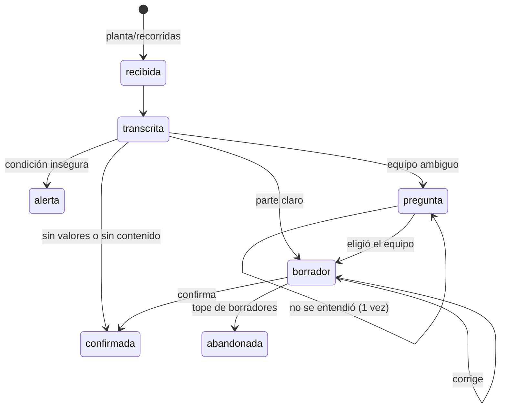

# dialogo-con-la-tablet Specification

## Purpose

Mostrarle al operador el parte que se entendió de su nota, preguntarle solo lo ambiguo, entender sus correcciones en
lenguaje de campo y cerrar el parte cuando lo confirma. El diálogo de cada nota se guarda en Postgres y sobrevive a un
reinicio.

## Requirements
### Requirement: Qué se manda en cada caso

El sistema SHALL mandar a `sistema/tablet`:

| Caso | Mensaje | `opciones` | Filas |
|---|---|---|---|
| Equipo ambiguo | Pregunta `TAB-<nota>-P<n>`: "Dijiste "la bomba" (descarga 112): ¿de qué bomba hablás?" | un nombre por candidato | ninguna |
| Parte claro | Borrador `TAB-<nota>-B<n>`: "Te leo el parte: … ¿Lo confirmás?" | ninguna | las del parte |
| Valor ambiguo | Borrador con el valor plausible y "Entendí 18 de diferencial…; lo anoto como 1,8" | "Sí, 1,8" / "No, 18" | las del parte |
| Fuera del rango histórico | Borrador con "Ojo: … fuera del rango de los últimos 45 días" | ninguna | las del parte |
| Solo estados u observaciones | Informe `TAB-<nota>-I` con `espera_respuesta: false`, "Lo registro así." | ninguna | las del parte |
| Sin lecturas | "No encontré lecturas…; la registré como recorrida sin novedad", sin espera | ninguna | una de `PLANTA` |
| Parte confirmado | `TAB-<nota>-OK` "Listo, guardé el parte. Gracias.", sin espera | ninguna | ninguna |

Un borrador de una nota clara SHALL NOT llevar `opciones`.

**Razón:** el operador virtual de la planta toma cualquier mensaje con `opciones` como una pregunta: suma en las notas
ambiguas y resta en las claras (criterios A4a y A4b). Compara los borradores por TAG, valor y unidad, e ignora las
filas sin valor: un parte con solo "parada, en reserva" no tiene nada que confirmar, así que se informa y se cierra.

#### Scenario: Nota clara
- **WHEN** la nota es "La dos está en 1640 psi de descarga"
- **THEN** sale un borrador con la fila B-102 1640 psi y sin `opciones`

#### Scenario: La bomba a secas
- **WHEN** la nota es "La bomba está en ciento doce de descarga"
- **THEN** sale primero una pregunta sin filas con las opciones La uno, La dos, La tres
- **AND** después de la elección, el borrador

#### Scenario: Solo un estado
- **WHEN** la nota es "La tres está parada, en reserva"
- **THEN** sale un informe sin espera de respuesta y el parte queda confirmado

### Requirement: Las respuestas en lenguaje de campo se entienden por reglas

El sistema SHALL entender estas formas de respuesta (con números hablados o en dígitos, con o sin tildes):

| Respuesta | Efecto |
|---|---|
| "Sí, confirmo", "Está bien", "Dale" | Confirma |
| "La uno estaba en ciento quince kilos, no en ciento cincuenta" | Corrige el valor (y la unidad si la dijo) |
| "Eso de 1,8 era del filtro B, no del A" | Mueve la lectura de equipo |
| "Lo de la dos es en psi, no en kilos" | Corrige la unidad |
| "Te faltó la tres, que estaba en 110" | Agrega la lectura, sin duplicarla si ya está |
| "Lo de la dos no lo dije" | Saca la lectura |
| "La dos" / "Ninguna de esas, era la dos" (a una pregunta) | Elige el equipo; si nombra varios, el último |

Una corrección de valor con unidad SHALL aplicarse a la fila del equipo que se mide en esa unidad, aunque el valor
mostrado sea de otra fila.

**Razón:** el operador corrige por equipo y unidad: "la dos estaba en 140 gotas por minuto, no en 56" habla del goteo
(dictado sin número), aunque el 56 sea la temperatura del rodamiento.

#### Scenario: Corrección de valor
- **WHEN** el borrador dice B-101 150 kg/cm² y el operador responde "No. La uno estaba en ciento quince kilos, no en ciento cincuenta. Corregilo y te confirmo."
- **THEN** sale un nuevo borrador con B-101 115 kg/cm²

#### Scenario: Corrección por unidad
- **WHEN** el borrador tiene B-102 rodamiento 56 °C y goteo sin valor, y el operador responde "la dos estaba en 140 gotas por minuto, no en 56"
- **THEN** el goteo queda en 140 gotas/min y la temperatura sigue en 56 °C

### Requirement: El diálogo tiene tope

Una pregunta de equipo que no se entiende SHALL repetirse una sola vez; si tampoco se entiende, el sistema SHALL tomar
el primer candidato y seguir al borrador, donde el operador puede corregir. Al llegar a `MAX_INTENTOS_BORRADOR` (3)
borradores sin confirmación, la nota SHALL quedar `abandonada` con el motivo registrado.

#### Scenario: Operador que no confirma
- **WHEN** el operador responde tres borradores sin confirmar ninguno
- **THEN** la nota queda abandonada y no se publican eventos de su parte

### Requirement: El diálogo sobrevive a un reinicio

Cada transición (nota, fase, intento, borrador, mensajes y respuestas) SHALL guardarse en Postgres en el momento. Al
arrancar, el sistema SHALL retomar las notas abiertas: las que no llegaron a borrador se reprocesan desde el audio; las
que estaban en pregunta o borrador vuelven a mandar su último paso. Una respuesta a un mensaje de antes del reinicio
SHALL encontrar su nota por el id del mensaje.

#### Scenario: Corte de luz con un borrador pendiente
- **WHEN** el sistema se reinicia con una nota en fase borrador
- **THEN** la tablet recibe de nuevo el borrador y la respuesta del operador se aplica a esa nota

### Requirement: El parte pasa de Borrador a Confirmado

Cada vez que sale un borrador a la tablet, el sistema SHALL guardar el parte de la nota en la tabla `partes` con
estado `Borrador` y las filas que se muestran. Cuando el operador confirma, el mismo parte SHALL pasar a `Confirmado`,
con las filas finales y la hora de confirmación; solo un parte `Confirmado` SHALL generar eventos. Un parte sin
valores (solo observaciones, como "parada, en reserva") o una nota sin contenido SHALL guardarse directo como
`Confirmado`, porque no hay nada que confirmar. Un parte que llega al tope de borradores SHALL quedar en `Borrador`.

**Razón:** el enunciado define los estados del parte (Borrador: armado desde las notas, sin confirmar; Confirmado: el
operador lo validó y recién entonces genera eventos) y el anexo pide que el parte pase de Borrador a Confirmado. La
tabla `partes` recibía solo el parte confirmado: el borrador vivía en la conversación de la nota.

#### Scenario: Borrador corregido y confirmado
- **WHEN** sale el borrador B1 de una nota y el operador corrige un valor
- **THEN** el parte está en `partes` como `Borrador` con las filas del borrador B2
- **AND** cuando el operador confirma, pasa a `Confirmado` y recién ahí se publican sus eventos

#### Scenario: Operador que no confirma
- **WHEN** el operador responde tres borradores sin confirmar ninguno
- **THEN** el parte queda como `Borrador` y no se publican eventos de su parte

#### Scenario: Enlace caído
- **WHEN** el enlace está caído durante el diálogo
- **THEN** el parte pasa igual de `Borrador` a `Confirmado`: la base está en la planta

